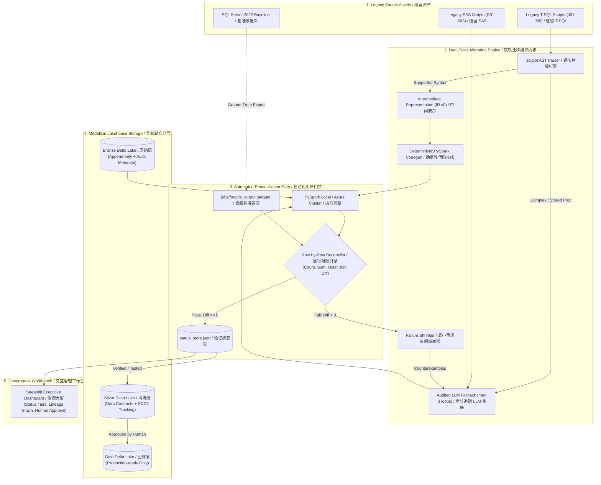

# System Architecture Design / 系统架构设计规范

> **Challenge Track / 赛题:** Legacy ETL/SAS to Azure Lakehouse (Challenge 03)  
> **Team / 团队:** UCD Team  
> **Owner / 负责人:** Tianyue Li / 李天悦  

---

## 1. Architectural Overview / 架构总览

The **EXL Migration Factory** is designed around the core principle: **"AI Proposes, the Compiler Disposes"**. It combines a deterministic AST-based compiler with an audited LLM fallback loop, paired with an automated dual-track record-for-record reconciliation engine and a Medallion Lakehouse storage architecture.

**EXL 自动化迁移工厂**围绕**【AI Proposes, the Compiler Disposes】**核心铁律构建。系统将基于 AST 的确定性代码编译器与受审计的 LLM 兜底回路深度结合，配合自动化逐行双轨对账引擎与 Medallion 奖牌湖仓存储架构，实现遗留 T-SQL/SAS 脚本向现代 PySpark Lakehouse 的工业级安全迁移。

---

## 2. Key Architecture Pillars / 核心架构支柱

### Pillar 1: Deterministic First, AI as Fallback / 确定性优先，AI 兜底
- **Deterministic Path (IR)**: High-confidence SQL patterns (SELECT, WHERE, JOIN, GROUP BY, CASE WHEN) are parsed into standardized AST via `sqlglot` and emitted deterministically. Identical input guarantees identical PySpark code.
- **确定性路径 (IR)**: 高可信度 SQL 算子（投影、过滤、关联、聚合、条件分支）经由 `sqlglot` 解析为 AST 并映射为结构化 IR，保证同一输入产出 100% 确定性的 PySpark 代码。
- **LLM Fallback & Self-Healing**: Complex control flow or SAS procedures enter the LLM loop with prompt logging and a hard limit of 3 self-healing attempts.
- **LLM 兜底与自愈**: 复杂控制流或 SAS 宏进入带审计日志的 LLM 回路，严格限制最多 3 次自愈重试，超时降级为 `Needs review`。

### Pillar 2: Record-for-Record Parity Verification / 逐行全量一致性对账
- **Row Count Verification**: Compares total record counts between Spark and SQL Server ground truth.
- **全量基数检验**: 比对两端输出行数，快速拦截掉单或脏增。
- **Value Checksum**: Validates numerical precision, rounding, and null semantics across key metrics.
- **数值指纹检验**: 验证核心金额与比率指标的和值，拦截隐式转换或截断偏差。
- **Full Outer Join Diff**: Identifies exact mismatched rows and feeds minimal counterexamples into the compiler.
- **全外连接比对**: 基于主键精准定位异常记录，并提取 1~3 条最小反例反馈给自愈引擎。

### Pillar 3: Medallion Lakehouse with Data Contracts / 带数据契约的奖牌湖仓
- **Bronze**: Append-only Delta Lake preserving raw schema and appending `_ingested_at`, `_source_file`.
- **Bronze 原始层**: 只追加模式，保留原始字段，严格注入系统审计元数据。
- **Silver**: Enforces declarative `ColumnContract` and `TableContract`, cleanses invalid ranges, and manages SCD2 versions.
- **Silver 清洗层**: 强制执行声明式契约约束、边界清洗、空值置换及 SCD2 缓慢变化维追踪。
- **Gold**: Production tier housing actuarial triangles and executive KPIs; guarded by deployment quality gates.
- **Gold 业务层**: 仅允许状态为 `Verified` 或 `Tested` 且获得人工审计签署的作业发布入库。

