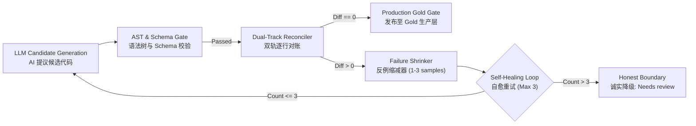

# Responsible AI Statement & Governance Note
# 负责任人工智能 (Responsible AI) 声明与治理规范

> **Challenge Track / 赛题:** Challenge 03: Agentic Data Platform Modernisation (Legacy ETL/SAS to Azure Lakehouse)  
> **Team / 战队:** UCD Team (Challenge 03)  
> **Authors / 联合撰写:** Tianyue Li / 李天悦, Pin-Yun Kuo / 郭小妘, Neeraj  
> **Version / 版本:** v1.0 (Frozen / 冻结生效)  

---

## 1. Executive Summary & Core Principle / 执行摘要与核心铁律

### English
In enterprise data lakehouse modernisation, unconstrained LLM code generation poses intolerable hallucination risks, precision loss, and regulatory exposure in financial/actuarial reporting. The **EXL Migration Factory** adheres to a non-negotiable operational tenet:

> **[Team First Principle: AI Proposes, the Compiler Disposes]**  
> Large Language Models (LLMs) never have autonomous write-access or final authoritative say over production migration. LLM outputs must be either syntactically verified Intermediate Representations (IR) conforming to strict Pydantic schemas, or candidate PySpark scripts subjected to automated, row-by-row reconciliation against ground-truth baseline executions.

### 中文
在企业级数据湖仓现代化演进中，无约束的 LLM 代码生成会带来不可接受的幻觉、数值精度漂移及精算合规风险。**EXL 自动化迁移工厂**恪守不可妥协的研发第一铁律：

> **【团队研发第一铁律：AI Proposes, the Compiler Disposes】**  
> 大语言模型（LLM）永远不拥有代码与生产迁移的最终决定权。LLM 的产出要么是经过语法检查并符合严格 Pydantic Schema 约束的结构化 IR，要么是必须通过全量逐行对账测试的 PySpark 脚本。

---

## 2. Key Pillars of Responsible AI / 负责任 AI 核心治理支柱

### Pillar 1: Deterministic-First Compilation / 确定性优先编译
- **Policy**: High-volume, high-frequency SQL patterns (Filters, Joins, Aggregations, Case-When) are compiled via deterministic AST transforms (`sqlglot`). No LLM tokens are consumed for predictable transformations, eliminating non-deterministic hallucinations.
- **策略**: 常见且高频的 SQL 算子统一由基于 `sqlglot` 的确定性语法树编译器处理。同一份输入保证 100% 产出相同逻辑的 PySpark 代码，零消耗 LLM Token，根除不确定性幻觉。

### Pillar 2: Record-for-Record Reconciliation & Evidence Chains / 逐条对账与可信证据链
- **Policy**: PySpark output must pass a 3-tier mathematical verification against local SQL Server ground truth (`oracle_output.parquet`):
  1. **Row Count Parity**: Zero missing rows, zero phantom extra rows.
  2. **Numerical Checksum**: Precision-bounded sum check (`abs_tolerance: 1.0e-9`).
  3. **Full Outer Join Key Diff**: Exact mismatch detection on all columns.
- **策略**: 候选 PySpark 必须与本地旧系统标准答案完成三重对账检验：行数比对（零漏单零脏增）、数值指纹检验（高精度容差）、主键全外连接比对。只有差异数严格为 0 时才允许进入验证状态。

### Pillar 3: Minimal Reproducible Failure Shrinking / 最小可重现反例缩减
- **Policy**: When reconciliation fails on millions of rows, the system does not dump massive unhelpful error logs into the model. Instead, the `Shrinker` algorithm isolates 1 to 3 minimal reproducible counterexamples with root-cause hints (e.g., integer division truncation, NULL comparison traps).
- **策略**: 当对账面对海量行数失败时，系统绝不向模型灌入成千上万行无序报错，而是启动反例缩减器，提炼出 1~3 条最小可重现反例及其语义成因（如整型除法截断、NULL 比较陷阱），驱动精准自愈。

### Pillar 4: Bounded Self-Healing & Fail-Safe Degradation / 有界自愈与安全降级
- **Policy**: The LLM self-healing loop is strictly capped at **3 iterations**. If parity is not achieved within 3 attempts, the job is automatically degraded to `Needs review`. Defective or unverified code is barred from Gold layer ingestion.
- **策略**: LLM 自愈重试严格限制为最多 **3 次**。若 3 次后仍未通过对账，系统坚决止损，自动将该作业降级为 `Needs review`，严禁任何带病代码注入 Gold 业务层。

### Pillar 5: Honest Boundaries / 诚实边界与透明度
- **Policy**: We believe true AI responsibility means transparently acknowledging operational boundaries. For complex SAS statistical procedures or undocumented legacy stored procedures, flagging them honestly as `Needs review` with counterexample proofs is rewarded over opaque, unreliable hallucinations.
- **策略**: 负责任的 AI 核心在于展现清晰的系统边界。对于复杂的 SAS 统计过程或极度晦涩的存储过程，坦诚标记为 `Needs review` 并附带可复现反例，远比黑盒化的幻觉代码更具工程价值与专业可信度。

### Pillar 6: Comprehensive Audit Trail & Prompt Provenance / 全生命周期审计与追溯
- **Policy**: Every prompt sent to the model, every generated intermediate script, every token cost, and every reconciliation diff is logged with UTC timestamps and SHA-256 hashes for regulatory auditability.
- **策略**: 每次送入模型的 Prompt、生成的中间代码草稿、Token 消耗以及对账 Diff 记录全部记录在案，附加 UTC 时间戳与校验指纹，满足金融级可审计与可追溯要求。

---

## 3. Conclusion & Human-in-the-Loop Sign-off / 结语与人工介入机制

AI is an accelerator, not the authority. In the **EXL Migration Factory**, human domain experts and automated mathematical verifiers retain absolute authority over the Lakehouse lifecycle.

AI 是强大的工程加速器，但绝非终审法官。在 **EXL 自动化迁移工厂**中，人类领域专家与自动化数学编译器共同筑起坚实的安全防线，确保遗留现代化进程的绝对可信与严密合规。

