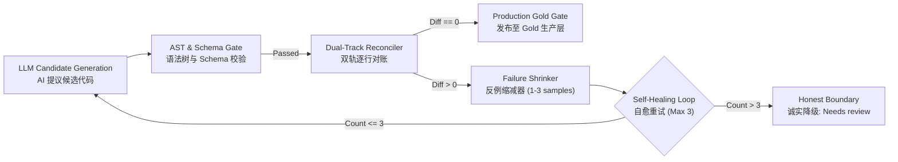

# Responsible AI Statement & Governance Note
# 负责任人工智能 (Responsible AI) 声明与治理规范

> **Challenge Track / 赛题:** Challenge 03: Agentic Data Platform Modernisation (Legacy ETL/SAS to Azure Lakehouse)  
> **Team / 战队:** UCD Team (Challenge 03)  
> **Authors / 联合撰写:** Tianyue Li / 李天悦, Pin-Yun Kuo / 郭小妘, Neeraj  
> **Version / 版本:** v1.0 (Frozen / 冻结生效)  

---

## 1. Executive Summary & Core Principle / 执行摘要与核心铁律

### English
In enterprise data lakehouse modernisation, unconstrained LLM code generation poses intolerable hallucination risks, precision loss, and regulatory exposure in financial/actuarial reporting. The **EXL Migration Factory** adheres to a non-negotiable operational tenet:

> **[Team First Principle: AI Proposes, the Compiler Disposes]**  
> Large Language Models (LLMs) never have autonomous write-access or final authoritative say over production migration. The deterministic path never calls an LLM: its Intermediate Representation (IR) is built by the parser. Any LLM output is a candidate PySpark script that must pass a static safety check and automated, row-by-row reconciliation against the legacy system's own output.

### 中文
在企业级数据湖仓现代化演进中，无约束的 LLM 代码生成会带来不可接受的幻觉、数值精度漂移及精算合规风险。**EXL 自动化迁移工厂**恪守不可妥协的研发第一铁律：

> **【团队研发第一铁律：AI Proposes, the Compiler Disposes】**  
> 大语言模型（LLM）永远不拥有代码与生产迁移的最终决定权。确定性路径完全不调用 LLM：其中间表示（IR）由解析器构建。LLM 的任何产出都只是候选 PySpark 脚本，必须先通过静态安全检查，再通过与旧系统真实输出的逐行对账。

---

## 2. Key Pillars of Responsible AI / 负责任 AI 核心治理支柱

### Pillar 1: Deterministic-First Compilation / 确定性优先编译
- **Policy**: High-volume, high-frequency SQL patterns (Filters, Joins, Aggregations, Case-When) are compiled via deterministic AST transforms (`sqlglot`). No LLM tokens are consumed for predictable transformations, eliminating non-deterministic hallucinations.
- **策略**: 常见且高频的 SQL 算子统一由基于 `sqlglot` 的确定性语法树编译器处理。同一份输入保证 100% 产出相同逻辑的 PySpark 代码，零消耗 LLM Token，根除不确定性幻觉。

### Pillar 2: Record-for-Record Reconciliation & Evidence Chains / 逐条对账与可信证据链
- **Policy**: PySpark output must pass a 3-tier mathematical verification against local SQL Server ground truth (`oracle_output.parquet`):
  1. **Row Count Parity**: Zero missing rows, zero phantom extra rows.
  2. **Numerical Checksum**: Precision-bounded sum check (`abs_tolerance: 1.0e-9`).
  3. **Full Outer Join Key Diff**: Exact mismatch detection on all columns.
- **策略**: 候选 PySpark 必须与本地旧系统标准答案完成三重对账检验：行数比对（零漏单零脏增）、数值指纹检验（高精度容差）、主键全外连接比对。只有差异数严格为 0 时才允许进入验证状态。

### Pillar 3: Minimal Reproducible Failure Shrinking / 最小可重现反例缩减
- **Policy**: When reconciliation fails on millions of rows, the system does not dump massive unhelpful error logs into the model. Instead, the `Shrinker` algorithm isolates 1 to 3 minimal reproducible counterexamples with root-cause hints (e.g., integer division truncation, NULL comparison traps).
- **策略**: 当对账面对海量行数失败时，系统绝不向模型灌入成千上万行无序报错，而是启动反例缩减器，提炼出 1~3 条最小可重现反例及其语义成因（如整型除法截断、NULL 比较陷阱），驱动精准自愈。

### Pillar 4: Bounded Self-Healing & Fail-Safe Degradation / 有界自愈与安全降级
- **Policy**: The LLM self-healing loop is strictly capped at **3 iterations**. If parity is not achieved within 3 attempts, the job is automatically degraded to `Needs review`. Defective or unverified code is barred from Gold layer ingestion.
- **策略**: LLM 自愈重试严格限制为最多 **3 次**。若 3 次后仍未通过对账，系统坚决止损，自动将该作业降级为 `Needs review`，严禁任何带病代码注入 Gold 业务层。

### Pillar 5: Honest Boundaries / 诚实边界与透明度
- **Policy**: We believe true AI responsibility means transparently acknowledging operational boundaries. For complex SAS statistical procedures or undocumented legacy stored procedures, flagging them honestly as `Needs review` with counterexample proofs is rewarded over opaque, unreliable hallucinations.
- **策略**: 负责任的 AI 核心在于展现清晰的系统边界。对于复杂的 SAS 统计过程或极度晦涩的存储过程，坦诚标记为 `Needs review` 并附带可复现反例，远比黑盒化的幻觉代码更具工程价值与专业可信度。

### Pillar 6: Comprehensive Audit Trail & Prompt Provenance / 全生命周期审计与追溯
- **Policy**: Every model call is logged per job (`out/<job>/ai_log.jsonl`): time, purpose, model name, full prompt, full answer and duration. Every repair attempt and its reconciliation result is kept in the job's report. AI-written code carries an `AI-GENERATED` banner. Human sign-offs are stored with the reviewer, a UTC timestamp and the SHA-256 of the reviewed code, and stop counting when that code changes.
- **策略**: 每次模型调用都按作业记录（`out/<job>/ai_log.jsonl`）：时间、用途、模型名称、完整 Prompt、完整回答与耗时。每次修复尝试及其对账结果都保留在作业报告中。AI 生成的代码带有 `AI-GENERATED` 标记。人工签核会记录审阅人、UTC 时间戳以及被审阅代码的 SHA-256，代码一旦变更签核即失效。

---

## 3. Data, Privacy, Bias, Limitations / 数据、隐私、偏差与局限

### Data used / 使用的数据
- **freMTPL2** (French motor third-party liability; `freMTPL2freq`, `freMTPL2sev`), a public actuarial teaching dataset. No client data and no personal identifiers; policy IDs are arbitrary numbers. A fixed sample (3,988 policies, 402 claims) is committed for reproducibility.
- **Synthetic adversarial rows** generated by the engine (NULLs, duplicate keys, mixed case, trailing spaces, negatives, boundary values).
- **freMTPL2**（法国车险第三者责任险）为公开的精算教学数据集，不含客户数据或个人身份信息。仓库内提交了固定样本（3,988 张保单、402 笔理赔）以便复现；另有引擎生成的合成对抗数据。

### Privacy & security / 隐私与安全
- The LLM receives legacy code, table schemas and **synthetic rows only**. The prompt builder refuses to include values from non-synthetic data (covered by an automated test).
- The LLM path runs on a **local model** (Ollama, `qwen2.5-coder:3b`); prompts do not leave the machine.
- AI-written code is statically checked before it runs: no file access, no extra imports, no JVM access.
- LLM 只会收到遗留代码、表结构与**合成数据行**；Prompt 构建器拒绝写入非合成数据的值（有自动化测试覆盖）。LLM 路径使用**本地模型**，Prompt 不出本机。AI 代码在执行前经过静态检查：禁止文件访问、额外 import 与 JVM 访问。

### Bias / 偏差
- The system migrates logic; it makes no decisions about people and trains no model. The relevant risk is **silent numerical drift** (e.g. integer division, NULL handling, case-insensitive text comparison), which would distort downstream pricing or reserving. Reconciliation against legacy output is the control for it.
- Reconciliation shows equality with legacy; it does not judge whether the legacy logic itself is fair.
- 系统只迁移逻辑，不对人做决策，也不训练模型。真正的风险是**静默的数值漂移**（整数除法、NULL 处理、不区分大小写的比较等），会扭曲下游定价与准备金。与旧系统输出对账是对应的控制手段。对账只能说明与旧系统一致，无法判断旧逻辑本身是否公平。

### Limitations (current results) / 局限（当前结果）
- **7 of 12 jobs are Verified, 0 are Tested, 5 are Needs review.** The small local model did not produce matching code for the MERGE job (J08) or the stored-procedure job (J09).
- **The three SAS jobs (S01-S03) have no legacy output to compare against** because no SAS runtime was available, so they cannot be rated above Needs review.
- "Verified" means the output matched legacy on the committed sample, the adversarial data and empty tables. It is evidence from testing, not a mathematical guarantee for all inputs.
- The deterministic path covers a defined SQL subset (single SELECT, joins, GROUP BY, CASE, common functions). Everything else goes to the LLM path with the reason recorded.
- **12 个作业中 7 个为 Verified、0 个为 Tested、5 个为 Needs review。** 本地小模型未能为 MERGE 作业（J08）与存储过程作业（J09）生成与旧系统一致的代码。**三个 SAS 作业没有旧系统输出可供对账**（没有 SAS 运行环境），因此只能停留在 Needs review。Verified 表示在已提交样本、对抗数据与空表上与旧系统一致，这是测试证据，而非对所有输入的数学保证。确定性路径只覆盖已定义的 SQL 子集，其余交给 LLM 路径并记录原因。

---

## 4. Conclusion & Human-in-the-Loop Sign-off / 结语与人工介入机制

No job reaches the Gold layer on a machine result alone: a named reviewer must sign off (`python -m engine approve <job> --reviewer <name>`), and the sign-off is bound to the exact code that was reviewed.

任何作业都不能仅凭机器结果进入 Gold 层：必须由具名审阅人签核，且签核绑定于当时被审阅的那份代码。

AI is an accelerator, not the authority. In the **EXL Migration Factory**, human domain experts and automated mathematical verifiers retain absolute authority over the Lakehouse lifecycle.

AI 是强大的工程加速器，但绝非终审法官。在 **EXL 自动化迁移工厂**中，人类领域专家与自动化数学编译器共同筑起坚实的安全防线，确保遗留现代化进程的绝对可信与严密合规。

